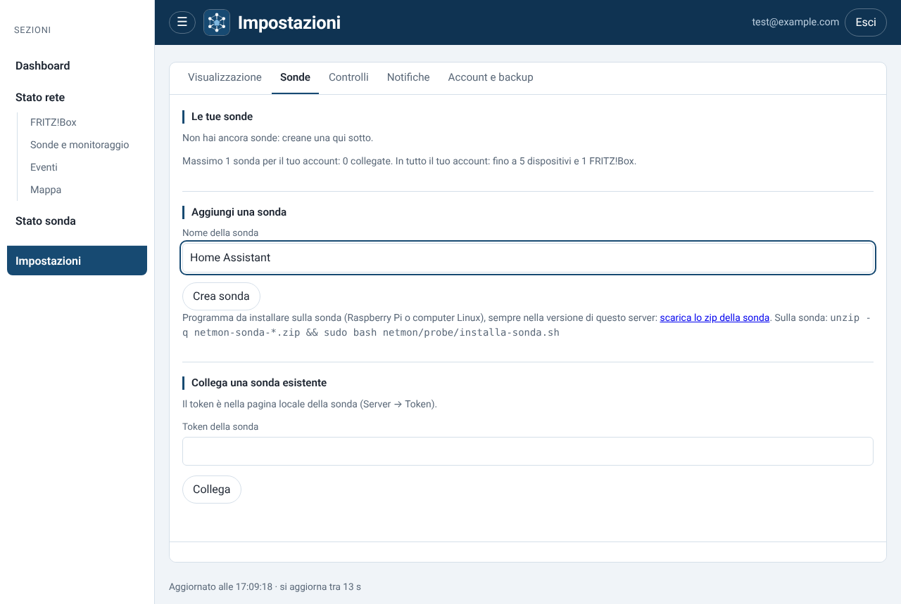
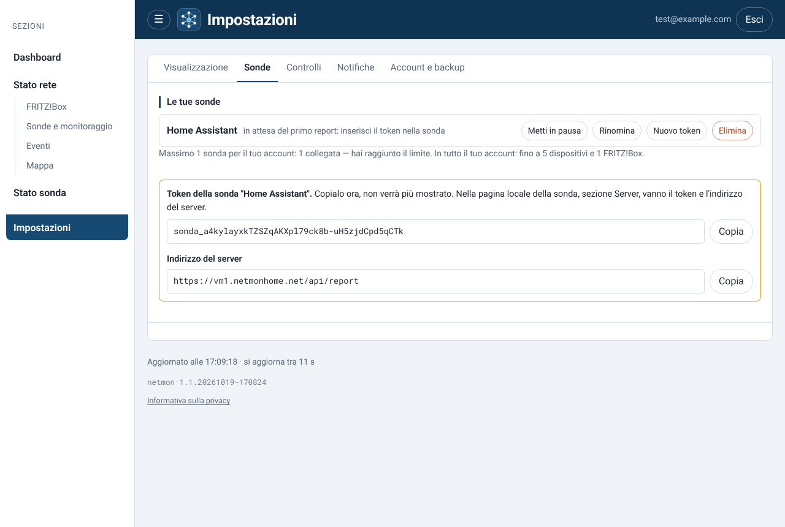
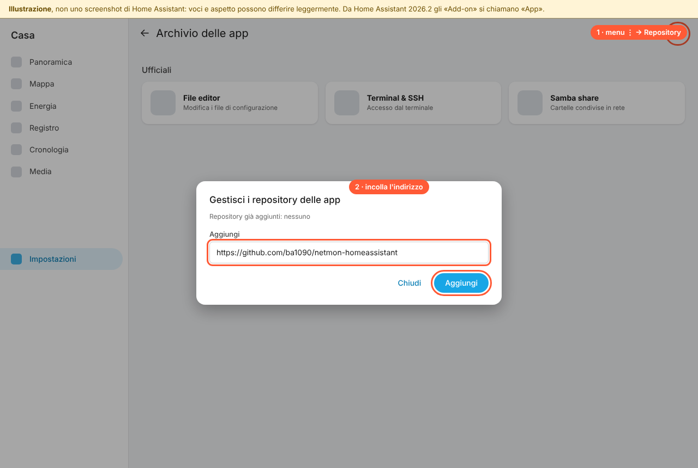
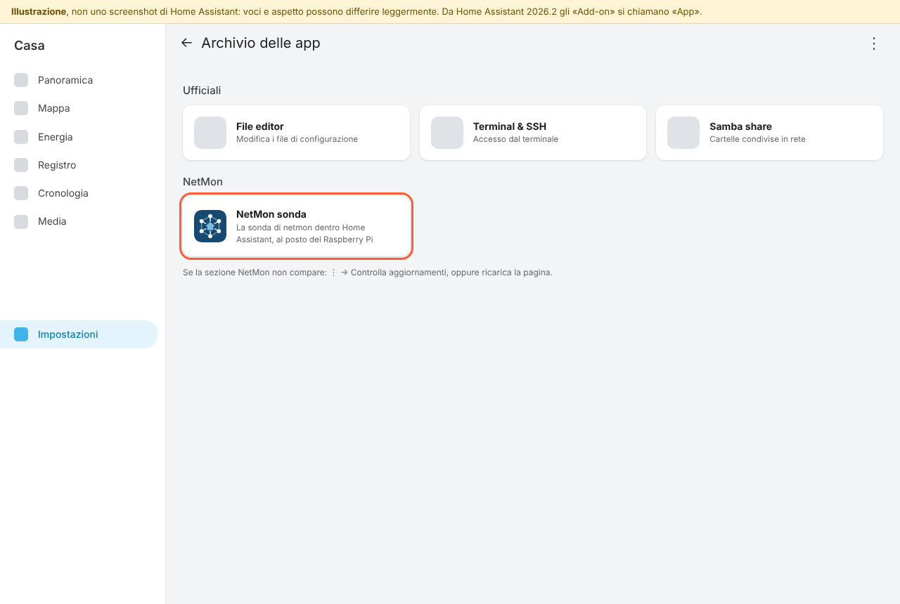
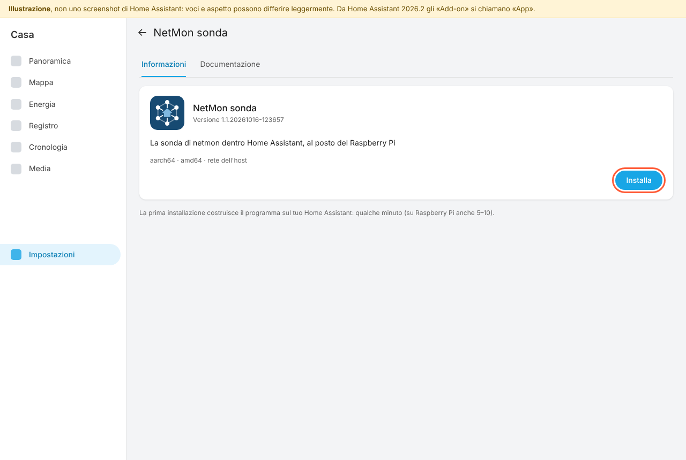
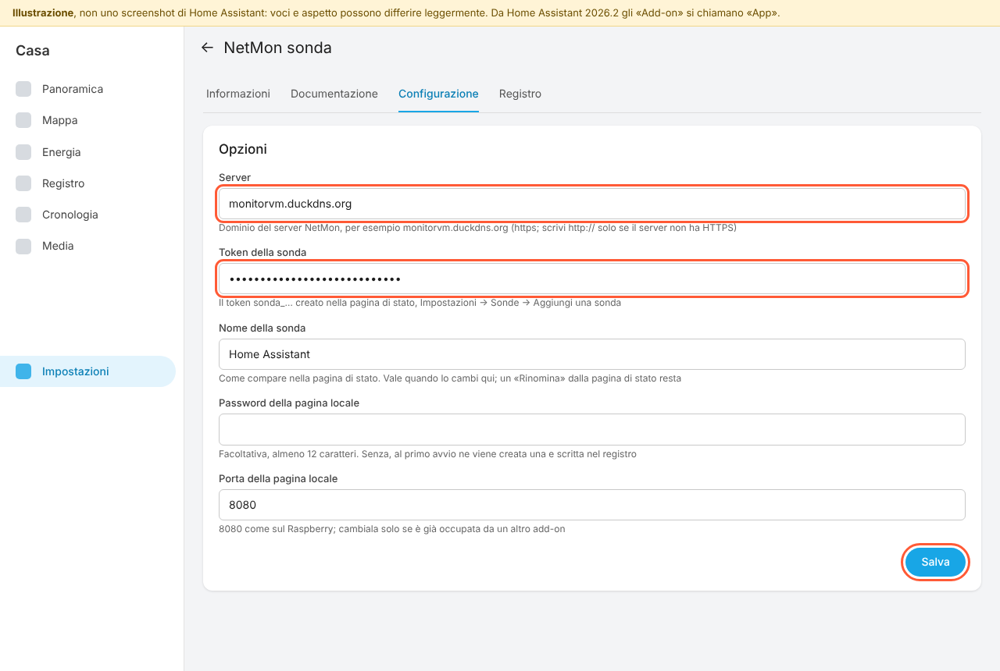
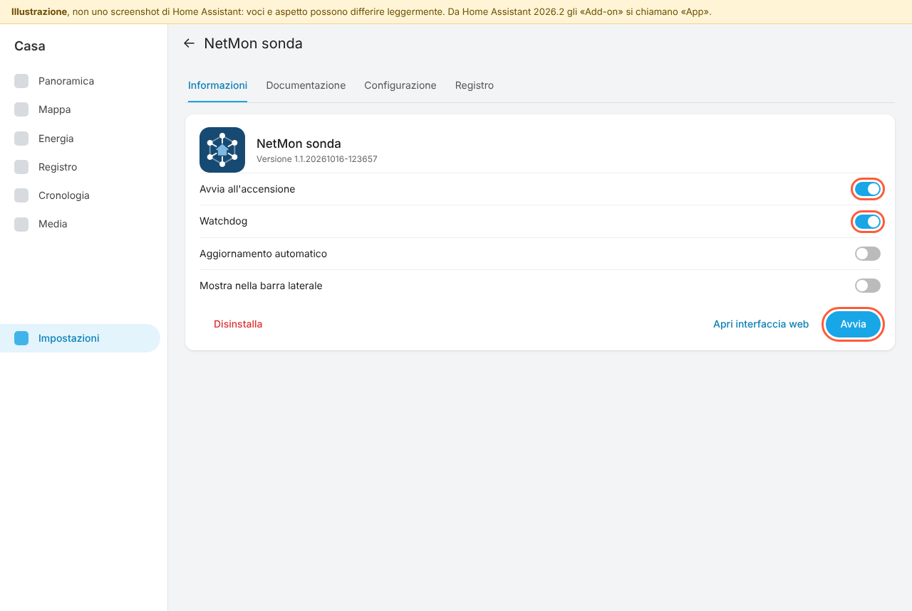
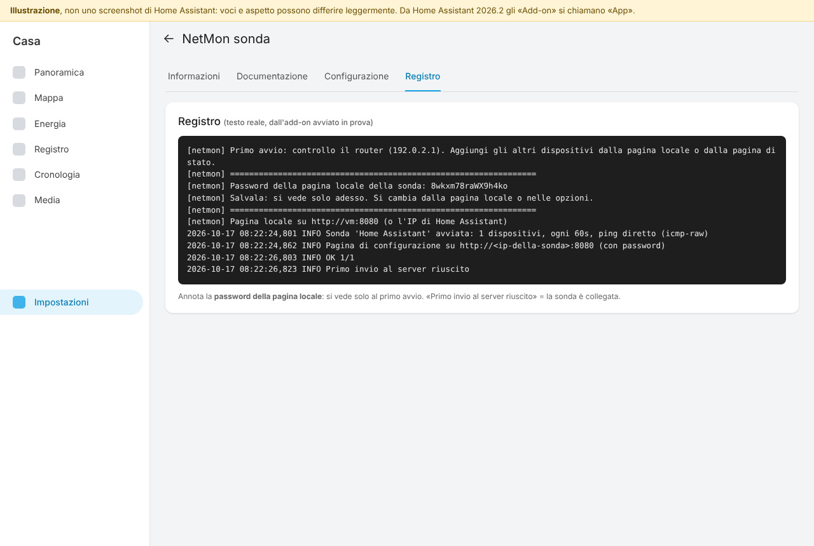
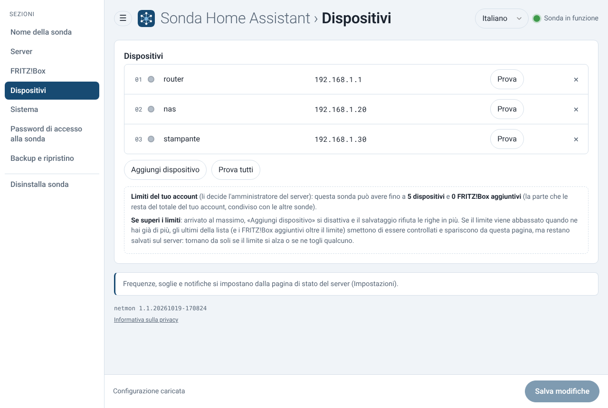
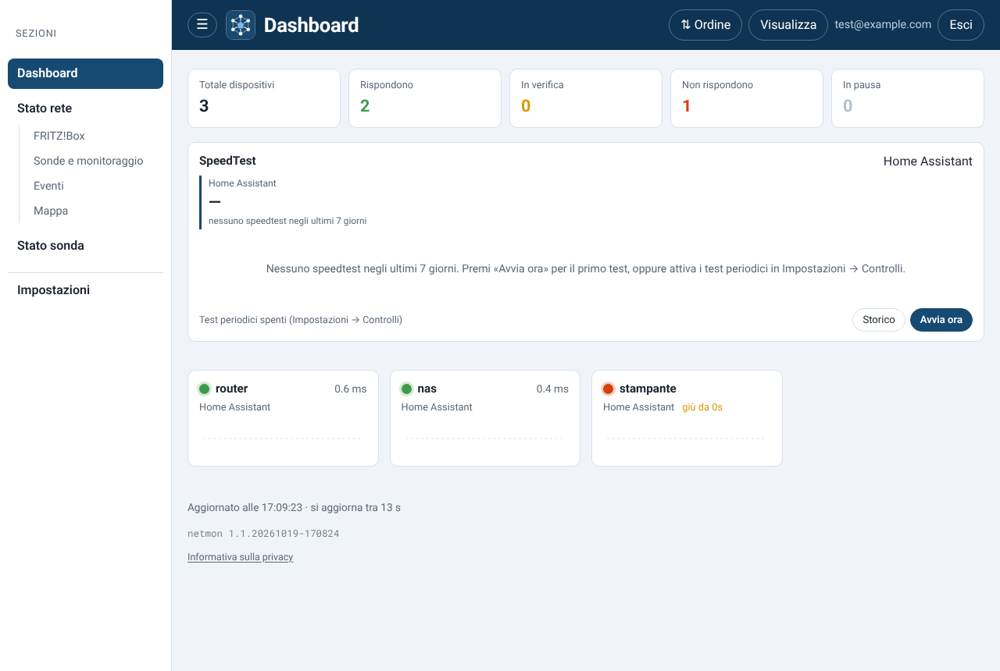

# NetMon per Home Assistant

Due modi per usare NetMon, il monitoraggio della rete di casa, con
Home Assistant:

| | Cosa fa | Come si installa |
|---|---|---|
| **NetMon sonda** (app/add-on) | la **sonda** gira dentro Home Assistant, al posto del Raspberry Pi: ping ai dispositivi, FRITZ!Box, speedtest e controlli delle porte, inviati al tuo server NetMon | *Impostazioni → App → Archivio delle app → Repository* · guida: [netmon-sonda/DOCS.md](netmon-sonda/DOCS.md) |
| **NetMon** (integrazione) | porta in Home Assistant lo **stato** di tutte le tue sonde e dei dispositivi, come entità per automazioni e dashboard | HACS → *Repository personalizzati* · guida: [HOME-ASSISTANT.md](HOME-ASSISTANT.md) |

Servono un server NetMon già installato e un account. Le due parti sono indipendenti: puoi usarne una
sola o entrambe.

Da Home Assistant 2026.2 gli add-on si chiamano **app**. Nelle versioni precedenti il menu è
*Impostazioni → Componenti aggiuntivi*.

## La sonda in Home Assistant, passo per passo

**Guida in PDF**, da stampare o mandare a chi installa: [NetMon-sonda-Home-Assistant.pdf](docs/NetMon-sonda-Home-Assistant.pdf)
(sorgente in `docs/guida/`, si rigenera con `node docs/guida/pdf.mjs`).

Serve Home Assistant OS (o Supervised): è l'installazione con il menu *App*.

**1. Crea la sonda nella pagina di stato di NetMon.** Vai in *Impostazioni → Sonde*, scrivi un nome e
premi *Crea sonda*:

**2. Copia il token** `sonda_…`, che si vede una volta sola:

**3. Aggiungi questo repository a Home Assistant.** Vai in *Impostazioni → App → Archivio delle app*,
apri il menu ⋮ → *Repository*, incolla `https://github.com/ba1090/netmon-homeassistant` e premi
*Aggiungi*:

**4. Apri NetMon sonda.** Compare nell'archivio, nella sezione NetMon; se non la vedi, ricarica la pagina:

**5. Installa.** La prima volta Home Assistant costruisce il programma: qualche minuto, su un
Raspberry Pi anche 5–10.

**6. Configura.** Nella scheda *Configurazione* scrivi il server (il dominio, per esempio
`vm1.netmonhome.net`), il token e il nome della sonda, poi premi *Salva*:

**7. Avvia.** Attiva *Avvia all'accensione* e *Watchdog*, poi premi *Avvia*:

**8. Controlla il registro.** Annota la **password della pagina locale**, che si vede solo al primo
avvio. La riga «Primo invio al server riuscito» vuol dire che la sonda è collegata:

**9. Aggiungi i dispositivi.** Puoi farlo dalla pagina di stato di NetMon (*Stato rete › Sonde e
monitoraggio*, pulsante **＋** accanto al nome della sonda), oppure dalla pagina locale
della sonda: pulsante *Apri interfaccia web*, o `http://homeassistant.local:8080` con la password
del punto 8. Dalla pagina locale si configura anche il FRITZ!Box.

**10. Fatto.** La sonda è in linea nella pagina di stato:

Le immagini 01, 02, 09 e 10 sono schermate vere di NetMon. Dalla 03 alla 08 sono illustrazioni:
in Home Assistant voci e aspetto possono essere un po' diversi.

Dettagli, differenze rispetto al Raspberry e soluzione dei problemi: [netmon-sonda/DOCS.md](netmon-sonda/DOCS.md).

## Aggiornamenti

La sonda si aggiorna come ogni app di Home Assistant: quando qui esce una versione nuova, Home
Assistant la propone tra gli aggiornamenti. L'integrazione si aggiorna da HACS.

Questo repository contiene solo la parte per Home Assistant. Il codice della sonda in
`netmon-sonda/probe/` è una copia di quello di NetMon, allineata a ogni rilascio.
